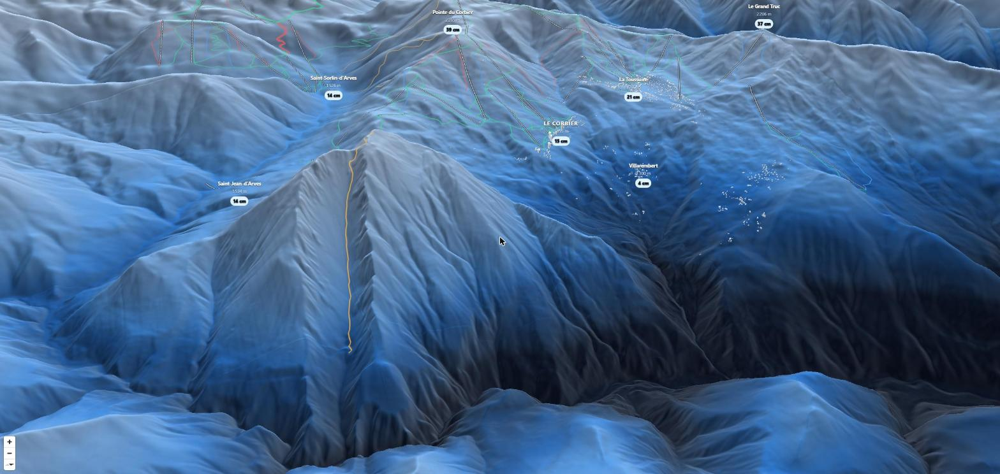

# Le Corbier — neige & météo

A snow and weather observatory for **Le Corbier (Les Sybelles, Savoie)**, published as a static site on GitHub Pages. French by default, with an English toggle.



## What it does

- **Now:** a relief map built from IGN's RGE ALTI, with buildings and lifts from BD TOPO, pistes from OpenStreetMap, and a 3D fly-around. You can paint it with forecast fresh snow by elevation, the rain–snow line hour by hour, or the latest Sentinel-2 snow map (20 m).
- **48 h:** a meteogram from twelve models (AROME HD, ICON-CH1/CH2, ICON-D2, ICON-2I, ICON-EU, ARPEGE, IFS, AIFS, UKMO, GFS). Each model is **corrected for its own local temperature bias** (by lead time and hour of day), then blended with **weights from its local score**. Also shows fresh snow by elevation, from 1,300 m to 2,430 m.
- **15 days:** 51 ECMWF ensemble members, giving daily snow probabilities and a fan of possible totals.
- **Models:** the verification behind the blend, lead day by lead day, cold seasons only. Snow days are scored against Météo-France's morning snow reports at Le Corbier itself (1,585 m). Temperature and precipitation are scored against the automatic station at Saint-Jean-d'Arves (1,573 m, 4 km away), because Le Corbier is not measured hourly.
- **Season:** EC46 weekly anomalies and SEAS5 monthly anomalies. If you add a key, the C3S multi-system forecast is shown too.
- **Archive:** the current season against 75 winters of ERA5, snow depth measured at Le Corbier, snowfall per winter with its trend, and "winter stripes".

Live forecasts are fetched by the visitor's browser from free, open services, so there are no keys and no server. A scheduled GitHub Action refreshes the slower products in `data/`.

## Publish it (one-off)

1. Create an empty **public** repository on GitHub named `corbier-meteo`. GitHub Pages on private repos needs a paid plan.
2. Push this folder:
   ```bash
   git remote add origin https://github.com/hlantuit/corbier-meteo.git
   git push -u origin main
   ```
   Alternatively, in GitHub Desktop use *File → Add local repository…*, pick this folder, then *Publish repository*.
3. **Settings → Pages:** set *Source* to *Deploy from a branch*, choose `main` and `/ (root)`. The site will appear at `https://hlantuit.github.io/corbier-meteo/`.
4. **Settings → Actions → General:** set *Workflow permissions* to *Read and write*, so the Action can commit refreshed data.
5. **Actions → Update data → Run workflow** with `all`. This bakes the buildings, lifts and pistes, the first Sentinel-2 snow map, and fresh archive and verification files. It takes about 10 minutes.

### Optional: C3S multi-system seasonal forecast

1. Add your Copernicus/ECMWF Data Store personal access token as a repository secret named `ECMWF_DATASTORE_KEY` (*Settings → Secrets and variables → Actions*). The token is on your profile page at <https://cds.climate.copernicus.eu>.
2. Accept the licence of the dataset *seasonal-postprocessed-single-levels* once on the CDS website.

The key is only used inside the Action and never reaches the web page. Without it, the page shows SEAS5 only.

## Schedule (UTC)

| When | What |
|---|---|
| Daily 05:17 | ERA5 archive, station snow depth → `data/climate.json` |
| Daily 11:43 | Sentinel-2 snow map → `data/snow/` |
| Mondays 03:41 | Model verification, biases and weights → `data/verification.json` |
| 2nd of the month | Buildings, lifts, pistes → `data/*.geojson` |
| 14th of the month | C3S multi-system seasonal forecast → `data/seasonal-c3s.json` |

## Methods in brief

- **Phase and amount of snow.** Each model's own snowfall height is used when available, otherwise its freezing level minus 300 m, otherwise wet-bulb temperature. Fresh-snow depth uses the temperature-dependent density of Hedstrom & Pomeroy (1998). No precipitation gradient with elevation is assumed.
- **Verification.** Open-Meteo's *Previous Runs* archive (lead days 0–7) is compared with Météo-France hourly data from the data.gouv.fr tabular API, November to April. Scores used:
  - temperature: MAE after removing each model's own bias, hour by hour;
  - precipitation: ETS for days with ≥ 1 mm and ≥ 10 mm (06–06 UTC);
  - snow days: ETS for days with ≥ 5 cm of fresh snow in Le Corbier's morning report (ski seasons).

  Weights are 1/MAE² for temperature and ETS² for precipitation. One station and two winters so far, so treat the rankings as indicative.
- **Ensemble.** ECMWF ENS temperatures receive the IFS bias correction before snow is computed.

## Run locally

```bash
python -m http.server 8000   # then open http://localhost:8000
```

`tests/` contains an offline render harness: Playwright with synthetic data for every external service.

## Data and licences

Open-Meteo (CC BY 4.0) carrying Météo-France, MeteoSwiss, DWD, ItaliaMeteo, ECMWF, Met Office and NOAA models · Météo-France climatological data via data.gouv.fr (Licence Ouverte 2.0) · IGN Géoplateforme: RGE ALTI, LiDAR HD, BD TOPO (Licence Ouverte 2.0) · OpenStreetMap contributors (ODbL) · Copernicus Sentinel-2 via Element 84 Earth Search · NASA GIBS (MODIS/VIIRS) · ECMWF ERA5, SEAS5, EC46 · Copernicus C3S · webcams by Skaping (links only).

Libraries: MapLibre GL JS (BSD-3), D3 (ISC), Manrope font (OFL).
